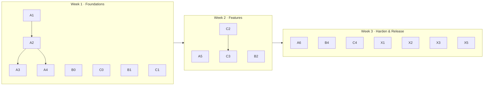

# Backlog

The 25 work items for the three-week run, prioritised. Full issue bodies live in
[`scripts/issues.json`](../scripts/issues.json) — running the bootstrap script
creates all of them on GitHub with labels, milestones and assignees.

**IDs** here (`A1`, `B2`, …) are stable references for the docs. Once the
script runs, it prints the mapping to real issue numbers (`A1 → #31`).

| Priority | Meaning | Rule |
| --- | --- | --- |
| **P0** | Must ship in `v1.1.0` | Do not drop. If at risk, escalate at the Friday review. |
| **P1** | Should ship | Droppable, but only by decision, never by drift. |
| **P2** | Stretch | Take only when the milestone is genuinely clear. |

---

## Track A — Identity, Security & Platform · @Raufnarejo505

| ID | Title | Size | Pri | Depends on | Why it matters |
| --- | --- | --- | --- | --- | --- |
| `A1` | Bootstrap the team workflow (templates, CODEOWNERS, labels, protection) | M | P0 | — | The rules must exist before the first PR, or the first PR teaches everyone they don't |
| `A2` | Backend test harness: pytest fixtures, DB isolation, auth helpers | M | P0 | A1 | **Critical path.** Nothing else can be tested until this exists |
| `A3` | Alembic baseline + first revision, replace `create_all` | M | P0 | A2 | Both week-2 features add tables; without this they need a database wipe |
| `A4` | CI v2: pytest vs real Postgres, ruff, ESLint, typecheck, caching | M | P0 | A2 | Makes the review gate mechanical instead of a promise |
| `A5` | Refresh tokens, rotation, `/auth/logout`, revoke on suspend | L | P0 | A3 | 24-hour access tokens with no revocation is the biggest security gap |
| `A6` | Rate-limit login/register (slowapi) | S | P1 | A4 | Public endpoints, no throttling, seeded default admin password |
| `A7` | Replace `python-jose` with `PyJWT` | S | P2 | A4 | `python-jose` is unmaintained with known CVEs; `PyJWT` is the maintained default |

## Track B — Catalog · @masoodamd

| ID | Title | Size | Pri | Depends on | Why it matters |
| --- | --- | --- | --- | --- | --- |
| `B0` | Python lint baseline: ruff config, format pass, pre-commit | S | P0 | — | **First PR** — smallest possible change that exercises the whole workflow |
| `B1` | Tests for listings & requirements: CRUD, ownership 403s, filters, pagination | M | P0 | A2 | These two routers are the most-used surface in the product |
| `B2` | Listing images: upload endpoint, static serving, migration, form + card | L | P0 | A3 | The single most-requested product gap; the demo looks twice as real with photos |
| `B4` | Consistent pagination envelope `{items,total,page,size,pages}` | S | P1 | A2 | Frontend currently re-derives totals; one contract removes a whole class of bugs |
| `B3` | Search: `sort` param, crop suggestions, supporting indexes | S | P2 | B1 | Buyers sort by price; farmers sort by freshness. Cheap, visible |
| `B5` | UX states: skeletons, empty states, inline validation | S | P2 | B2 | Every list page currently flashes empty before data arrives |

## Track C — Deal Room · @ZahidWebS

| ID | Title | Size | Pri | Depends on | Why it matters |
| --- | --- | --- | --- | --- | --- |
| `C0` | Frontend lint baseline: ESLint, Prettier, `lint`/`typecheck` scripts | S | P0 | — | **First PR** — same reason as B0; note `package.json` has no lint script at all today |
| `C1` | Tests for offer counter flow and order state machine | M | P0 | A2 | The riskiest logic in the system: money, state, and two concurrent actors |
| `C2` | Offer race guard: reject action on non-pending offer, row lock | M | P0 | C1 | A double-accept today would create two orders — a real correctness bug |
| `C3` | In-app notifications: table, endpoints, unread badge, WS push | L | P0 | A3, C2 | Offers and status changes are only visible if you happen to be on the page |
| `C4` | WebSocket resilience: reconnect with backoff, resync, status indicator | M | P1 | C3 | A dropped socket currently leaves the UI silently stale forever |
| `C5` | Order timeline polish: cancellation reason, actor names, timestamps | S | P2 | C1 | The audit trail exists in the database but barely surfaces in the UI |
| `C6` | Ratings & reviews after a completed order | M | P2 | C1 | Closes the trust loop for a marketplace; the most valuable "next feature" |

## Shared / release

| ID | Title | Owner | Size | Pri | Depends on | Why it matters |
| --- | --- | --- | --- | --- | --- | --- |
| `X1` | Release `v1.1.0`: release PR `develop → main`, tag, notes | Rauf | S | P1 | all P0 | The artifact the project is judged on |
| `X2` | Demo seed script: farmers, buyers, listings, a live conversation | Masood | S | P1 | A3 | Removes the "create five accounts live" from every demo |
| `X3` | Docs refresh: README, API tables, env vars, architecture | Rauf | S | P1 | A5, B2, C3 | Docs already good; must not drift from the released code |
| `X5` | Compose hardening: backend healthcheck, frontend depends_on condition | Masood | S | P1 | — | Cold start currently races the API |
| `X4` | Accessibility pass: labels, focus rings, keyboard nav, contrast | Zahid | S | P2 | B2 | Cheap, visible, and a differentiator in a final-year assessment |

---

## Shape of the plan

12 P0 · 7 P1 · 6 P2. If the run slips, **P2s go first**, then the lowest-value
P1. Tests, reviews and migrations are never the thing that gets cut.

---

## Deliberately out of scope

Listing these explicitly is as much a planning act as listing what is in — it
stops the three-week run from quietly turning into a six-week one.

| Not doing | Why |
| --- | --- |
| Email notifications | Needs SMTP credentials, a provider, and deliverability handling. In-app notifications (`C3`) deliver 80% of the value for 20% of the work. |
| Migrating JWT from `localStorage` to httpOnly cookies | Correct long-term, but it touches every page and every API call. It is the first item for `v1.2`. |
| Deployment to a cloud host | Not needed to demonstrate the system; `docker compose` on a laptop is the deliverable. |
| Real payment integration | Out of FYP scope and would introduce a compliance surface nobody has time to handle. |
| Kubernetes / infrastructure-as-code | Straightforwardly disproportionate for three services on one machine. |
| A second database (Mongo/Redis) | PostgreSQL already covers it; the operational cost would eat a week. |

---

## What "done" looks like for the whole backlog

- Every P0 has a merged PR and a green CI run
- Every P1 is either merged or consciously moved to `v1.2` with a comment
- No issue is closed without code or an explicit decision comment
- The milestone closes at 100% or with a documented carry-over
