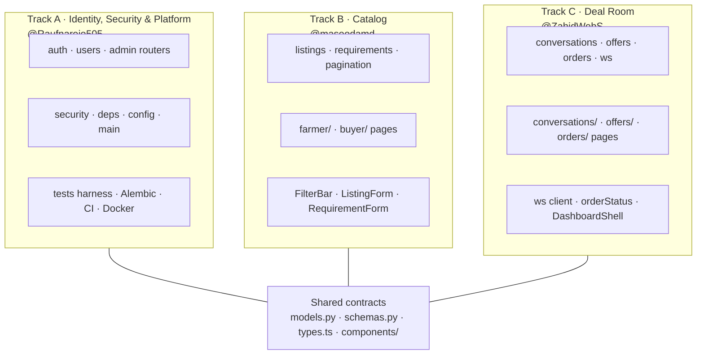
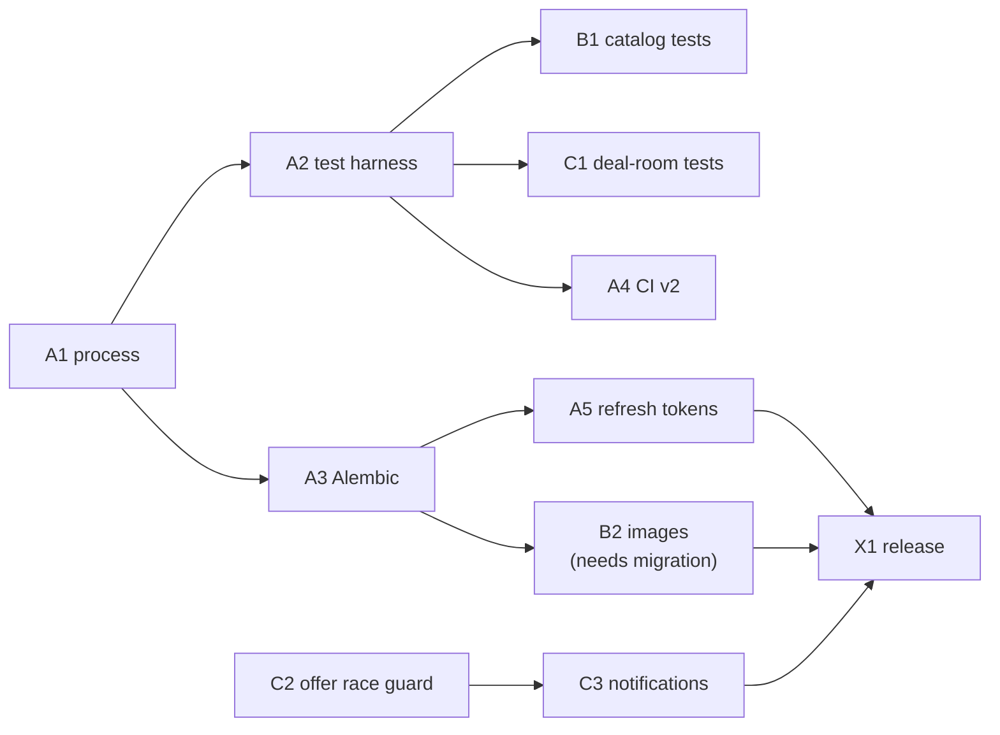

# Task Assignment & 3-Week Delivery Plan

**Team:** Abdul Rauf [@Raufnarejo505](https://github.com/Raufnarejo505) ·
Masood Ahmed [@masoodamd](https://github.com/masoodamd) ·
Zahid Hussain [@ZahidWebS](https://github.com/ZahidWebS)

**Window:** Mon 9 Nov → Sun 29 Nov 2026 (3 weeks, ~30 h each)

**Companion docs:** [TEAM_PLAYBOOK.md](TEAM_PLAYBOOK.md) (the rules) ·
[BACKLOG.md](BACKLOG.md) (the work items) · [GITHUB_SETUP.md](GITHUB_SETUP.md) (settings)

---

## 1. How the work is split — three vertical tracks

The instinct is to split by layer: one person on backend, one on frontend, one
on database. **Do not do that here.** Every feature in AgriMatch cuts through
all three layers, so a layer split means every feature needs all three people
and nothing ships until the slowest link finishes.

Instead we split **by product vertical**. Each person owns one slice of the
product *end to end* — router, schema, page, component, tests — and therefore
owns a coherent set of files.

### File ownership table

This is the table `CODEOWNERS` encodes, and the reason merge conflicts should
be rare. **If a file is yours, you are the default reviewer for it.**

| Track | Owner | Backend | Frontend | Everything else |
| --- | --- | --- | --- | --- |
| **A** Identity, Security & Platform | Rauf | `routers/auth.py`, `routers/users.py`, `routers/admin.py`, `security.py`, `deps.py`, `config.py`, `main.py`, `database.py` | `app/login/`, `app/register/`, `app/profile/`, `app/admin/`, `lib/auth.ts` | `tests/conftest.py`, `alembic/`, `.github/`, `docker-compose.yml`, `requirements.txt` |
| **B** Catalog | Masood | `routers/listings.py`, `routers/requirements.py`, `pagination.py` | `app/farmer/`, `app/buyer/`, `FilterBar`, `ListingForm`, `RequirementForm`, `Pagination`, `lib/filters.ts` | `scripts/seed_demo.py` |
| **C** Deal Room | Zahid | `routers/conversations.py`, `routers/offers.py`, `routers/orders.py`, `ws.py` | `app/conversations/`, `app/offers/`, `app/orders/`, `lib/ws.ts`, `lib/orderStatus.ts`, `DashboardShell` | — |
| **Shared** | Rauf reviews | `models.py`, `schemas.py`, `lib/api.ts` | `types.ts`, `components/*` (except owned files), `globals.css`, `app/layout.tsx` | `README.md`, `docs/` |

### Why these three tracks

- **A goes to Rauf** because it is the cross-cutting surface — migrations, CI,
  the auth model — where a mistake breaks everyone. He wrote the original
  design and is the fastest route to a working test harness, which is the
  critical-path item that unblocks B and C.
- **B and C are clean, self-contained product surfaces** with a clear
  definition of done and an obvious demo. They are also genuinely different
  work: B is CRUD + search + forms; C is state machines and realtime. That
  makes them easy to review independently.
- **Nobody's daily work touches anybody else's daily work.** The only shared
  files are `models.py`, `schemas.py` and `types.ts`, and the playbook has a
  protocol for those.

### Load balance

| Person | P0 (must) | P1 (should) | P2 (stretch) | Total |
| --- | --- | --- | --- | --- |
| Rauf | A1 A2 A3 A4 A5 — 25 h | A6 — 2 h | A7 — 3 h | **~30 h** |
| Masood | B0 B1 B2 — 16 h | B4 X2 X5 — 9 h | B3 B5 — 6 h | **~31 h** |
| Zahid | C0 C1 C2 C3 — 19 h | C4 — 4 h | C5 C6 X4 — 11 h | **~34 h** |

Plus ~4 h each of reviews, which is not optional and is not counted above.
If a week slips, drop P2s first, then the lowest-value P1 — never a test, a
review or a migration.

---

## 2. What each person is actually learning

The project is the vehicle; the skill is the point. Spelling this out makes the
assignment defensible in a viva.

| | Rauf | Masood | Zahid |
| --- | --- | --- | --- |
| **Domain** | AuthN/AuthZ, session security, migrations | Search, filtering, file upload, forms | State machines, realtime, concurrency |
| **Engineering** | Test infrastructure, CI pipelines, release management | API design, pagination contracts, validation | Race conditions, WebSocket lifecycle, event fan-out |
| **Process** | Maintaining a repo: protection rules, CODEOWNERS, releases | Being a good reviewer on unfamiliar code | Debugging distributed-ish behaviour (2 clients, 1 socket) |

Each of you therefore ends up able to explain a different third of the system
confidently — which is exactly what a good demo and a good viva need.

---

## 3. Week 1 — Foundations (9–15 Nov)

Goal: **by Friday, three people can work in parallel without stepping on each
other, and quality is enforced by a machine rather than by memory.**

| Day | Rauf (A) | Masood (B) | Zahid (C) |
| --- | --- | --- | --- |
| **Mon 9** | Apply [GITHUB_SETUP.md](GITHUB_SETUP.md), run the bootstrap script (`A1`), push `chore/process-bootstrap` PR. Kickoff call, 30 min. | `docker compose up`, click through farmer + buyer flows. Comment a test plan on `B1`. | `docker compose up`, run two browsers, negotiate an offer end to end. Comment a test plan on `C1`. |
| **Tue 10** | `A2` test harness + first smoke tests. | **`B0` first PR** — ruff baseline. Small, fast, merges today. | **`C0` first PR** — ESLint + Prettier baseline. Merges today. |
| **Wed 11** | `A3` Alembic baseline. Review B0 and C0. | Review C0. Start `B1` catalogue tests. | Review B0. Start `C1` deal-room tests. |
| **Thu 12** | `A4` CI v2 — pytest job, Postgres service, lint jobs. | `B1` continues. | `C1` continues. |
| **Fri 13** | Sprint review 20 min. Merge what is green. Release nothing yet. | Open `B1` PR. Review A's. | Open `C1` PR. Review A's. |

**Exit criteria for week 1**

- [ ] Branch protection live on `main` and `develop`; nobody can push directly
- [ ] `pytest` runs in CI against a real Postgres and passes
- [ ] `ruff` and `npm run lint` gate every PR
- [ ] Alembic is the source of truth for schema
- [ ] Everyone has merged at least one PR of their own, and reviewed one
- [ ] 25 issues exist, labelled and milestoned

> **Why week 1 is tests, not features.** Both newcomers are editing code they
> have never read, written by someone else. Writing tests is the fastest
> possible way to read it deeply — you cannot test an endpoint you do not
> understand. It is also the only work that makes week 2's parallel feature
> work safe. This is a deliberate trade, not busywork.

---

## 4. Week 2 — Ship one visible feature each (16–22 Nov)

Goal: **three demos, one per track, from a shared `develop`.**

| Day | Rauf (A) | Masood (B) | Zahid (C) |
| --- | --- | --- | --- |
| **Mon 16** | `A5` refresh tokens — schema + migration + endpoints | `B2` image upload — storage + endpoint + migration | `C2` offer race guard — `FOR UPDATE`, state check |
| **Tue 17** | `A5` continues — rotation, revoke on suspend | `B2` continues — form + card display | `C2` tests, then `C3` notification table |
| **Wed 18** | **Mid-sprint check.** Everyone rebases, runs the full stack, files bugs found | | |
| **Thu 19** | `A5` frontend: silent refresh in `lib/api.ts` | `B2` polish, docs | `C3` endpoints + unread badge |
| **Fri 20** | Sprint review. `A6` if time. | Review C. `B4` if time. | Sprint review. `C4` if time. |

**Exit criteria for week 2**

- [ ] Access tokens short-lived; refresh + logout work; suspended user's refresh token dies
- [ ] A farmer can upload a photo and a buyer can see it in search results
- [ ] Two browser windows cannot double-accept the same offer
- [ ] `develop` tagged-deployable: `docker compose up` from a clean clone works
- [ ] Every PR this week had a non-author approval before merge

**Review rotation this week:** Rauf reviews C, Zahid reviews B, Masood reviews A.

---

## 5. Week 3 — Harden, document, release (23–29 Nov)

Goal: **`v1.1.0` on `main`, tagged, documented, demoable in ten minutes.**

| Day | Everyone |
| --- | --- |
| **Mon 23** | Bug-fix day. Triage everything filed during week 2. Zahid `C4` reconnect; Masood `X2` demo seed data. |
| **Tue 24** | Masood `X5` compose healthchecks; Zahid `X4` accessibility pass; Rauf `X3` docs refresh across all tracks. |
| **Wed 25** | **Feature freeze, 12:00.** Only bug fixes and docs now. Full manual regression on `develop`. Screenshots for the report. |
| **Thu 26** | Release PR `develop → main`, squash-merge, tag `v1.1.0`, release notes from the closed milestone. |
| **Fri 27** | Retrospective (30 min). Back-merge `main` into `develop`. Stretch issues only if the milestone is genuinely empty. |
| **Sat/Sun 28–29** | Final polish, presentation deck, report evidence pack. |

**Release checklist (Rauf owns, everyone contributes)**

- [ ] Every `v1.1.0` milestone issue is closed or explicitly moved out
- [ ] CI green on `develop`
- [ ] `README.md` reflects the actual API and env vars
- [ ] `docker compose up --build` from a clean clone works on a machine that is not yours
- [ ] Demo accounts seeded, walkthrough scripted end to end
- [ ] `v1.1.0` tag pushed, release notes written
- [ ] `main` back-merged into `develop` so the two never diverge again

---

## 6. Critical path and dependencies

Two things gate the whole plan, and both are Rauf's, both in week 1:

1. **`A2` test harness** — nothing can be tested until it exists. Target:
   merged Wednesday of week 1.
2. **`A3` Alembic** — B2 (images) and A5 (refresh tokens) both add tables.
   Without migrations those land as `create_all` changes that force a database
   wipe. Target: merged Thursday of week 1.

If either slips, Masood and Zahid switch to P2 work rather than starting a
feature that will need rework.

---

## 7. Review rotation

| Week | Every PR is reviewed by |
| --- | --- |
| 1 | Whoever is free — this is the week to learn reviewing |
| 2 | A → by C · B → by A · C → by B |
| 3 | Same rotation, plus a second reviewer on anything touching `models.py` |

Rule of thumb: **you may not review a PR in your own track's files.** If someone
else touched your files, you review; if it is your own, the third person does.

---

## 8. Risks and what we do about them

| Risk | Likelihood | Mitigation |
| --- | --- | --- |
| Newcomers blocked waiting on `A2`/`A3` | Medium | They start with `B0`/`C0` (independent, same day) and test *plans* in issue comments, which need no code |
| Week-2 features collide in `models.py` | Medium | Both add at end of file; declare edits in the issue; Rauf merges in order |
| Someone falls behind >1 day | Medium | Friday review catches it; cut a P2, redistribute one P1, never compress the review step |
| Releases slip into week 3 | High if week 2 overruns | Freeze is Wednesday 12:00 regardless — ship what is green, move the rest to v1.2 |
| "It works on my machine" | High | `docker compose up` from a clean clone is a release checklist item, run by someone else |
| A token or password gets committed | Low | `gitleaks`/GitHub secret scanning on; `.gitignore` already excludes `.env` |

---

## 9. Definition of a good final week

If everything goes to plan, by 29 November the repository shows:

- 25+ issues, every one closed by a linked PR
- 25+ merged pull requests, each with at least one review comment
- Three contributors in the GitHub contributors graph, not one
- A green CI badge that means something, because it runs tests
- A `v1.1.0` release with generated notes
- A project board that visibly moved from Backlog to Done across three weeks

That is the artifact worth showing in a final-year review: not just a working
marketplace, but a recorded, reviewable, three-person engineering process.
