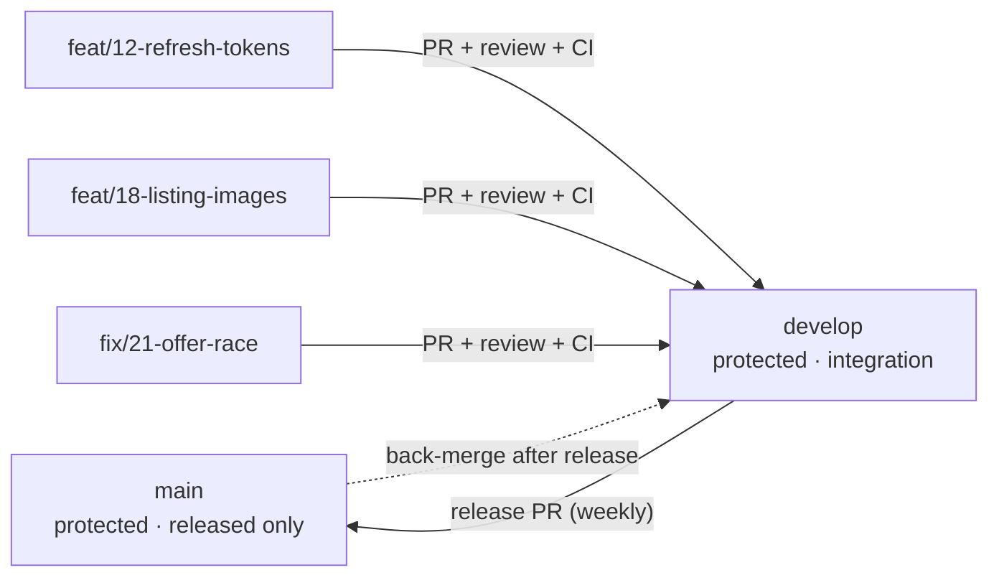
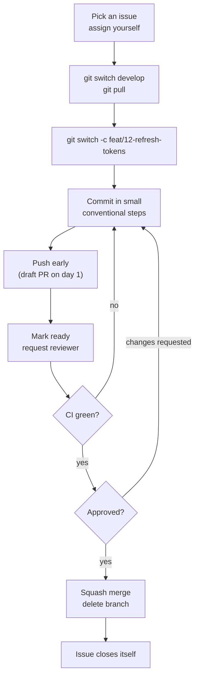
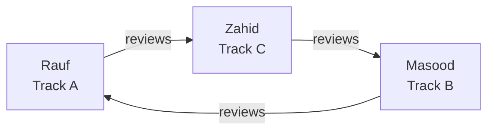

# AgriMatch Team Playbook

How the three of us work on this repository. Written for a team of three on a
three-week clock, borrowing the rules a small production team would use — minus
the ceremony that does not pay for itself at this size.

> **Read time:** ~15 minutes. **Payoff:** nobody blocks anybody else, no PR sits
> unreviewed for two days, and the repository tells the story of how the work
> was done.

---

## 1. Where we are starting from

An honest read of the repository as it stands:

| Signal | Now | What it should be |
| --- | --- | --- |
| Commits | 39, all by one author | Three authors, interleaved |
| Pull requests | 0 | Every change lands through a reviewed PR |
| Issues | 0 | 20+ issues, closed by PRs |
| Tests | 0 | Backend suite in CI, growing per track |
| Branches | 9, seven of them merged and abandoned | At most 3 live branches at a time |
| Branch protection | off | On, for `main` and `develop` |
| Migrations | none (`create_all`) | Alembic, one revision per schema change |
| Linters | none | `ruff` + ESLint in CI |

None of this is a criticism of the code — the code is solid and the commit
history is genuinely well-formed. The gap is *evidence of collaboration* and
*the safety net that lets three people edit one codebase at the same time*.
Both of those are fixable in week 1.

---

## 2. The branch model



- **`main`** — what we would demo or hand in. Only ever receives release PRs
  from `develop`. Tagged (`v1.1.0`) at each release.
- **`develop`** — the integration branch. Every feature PR lands here first.
- **Work branches** — short-lived, one issue each, deleted on merge.

### Branch naming

```
<type>/<issue-number>-<short-slug>
```

| Good | Bad | Why |
| --- | --- | --- |
| `feat/12-refresh-tokens` | `my-branch` | No issue link, no meaning |
| `fix/21-offer-race-condition` | `zahid-work` | Who is not information |
| `chore/7-process-bootstrap` | `patch-1` | Nobody can date or scope it |

Types: `feat`, `fix`, `chore`, `docs`, `test`, `refactor`, `perf`, `ci`.

Branches live **at most a few days**. A branch older than a week is a merge
conflict waiting to happen — split the issue instead.

---

## 3. The daily loop



**Open the PR on day one, as a draft.** A draft PR is free visibility: it tells
the other two what you are touching, it starts CI early, and it removes the
"big reveal" at the end that reviewers dread.

### Commit messages — Conventional Commits

```
<type>(<scope>): <imperative summary>

<optional body: why, not what>

<optional footer: Closes #12, BREAKING CHANGE: ...>
```

```
feat(auth): add refresh token rotation
fix(offers): reject accept on a non-pending offer
test(catalog): cover listing ownership 403s
chore(ci): cache pip downloads between runs
```

Scopes we actually use: `auth`, `users`, `catalog`, `offers`, `orders`, `ws`,
`admin`, `ui`, `ci`, `docker`, `deps`, `docs`.

Because we **squash-merge**, the PR title becomes the commit on `develop`. So
the PR title must follow the same convention — and the many small commits
inside your branch only need to be honest, not perfect.

---

## 4. Issues — every unit of work starts here

An issue is a promise: *this is what "done" means*. It protects you from
building the wrong thing and the reviewer from guessing.

**Every issue needs, at minimum:**

1. An imperative title — "Add refresh tokens and logout".
2. A `Context` paragraph — why this exists.
3. `Acceptance criteria` as checkboxes — these become the tests.
4. One `area/*` label, one `type/*` label, one `size/*` label, one priority.

Use the **Task** template. Four labels carry the planning load:

| Label group | Values | Meaning |
| --- | --- | --- |
| `type/*` | `feature` `bug` `chore` `docs` `test` `security` | Nature of the work |
| `area/*` | `backend` `frontend` `db` `realtime` `devops` | Where it lands |
| `size/*` | `S` (~1–2 h) `M` (~3–5 h) `L` (~6–10 h) | Estimate, not a promise |
| `P0` `P1` `P2` | — | `P0` blocks the release, `P2` is parkable |

Plus `good first issue` for anything a newcomer can ship inside an hour, and
`blocked` (with a comment naming the blocker) when you are stuck on someone
else.

**Assignment rules**

- Assign yourself when you *start*, not when you are told to.
- At most **two** open issues per person. A third means something is stuck.
- If you are stuck for more than half a day, comment on the issue and either
  pair on it or hand it back. Silence is the only real failure mode.

**Closing** — add `Closes #12` to the PR description. GitHub closes the issue
on merge. Never close by hand unless you actually decided not to do it, and
then say why in a comment.

---

## 5. Pull requests

### Before you open

```bash
git switch develop && git pull          # rebase onto the latest develop
git switch feat/12-refresh-tokens
git rebase develop                      # keep history linear
pytest && npm run build                 # run it locally first
```

### The rules

| Rule | Detail |
| --- | --- |
| **Target** | Always `develop`. `main` only receives release PRs. |
| **Size** | Under ~400 changed lines. Bigger → split, or explain why in the description. |
| **Scope** | One concern. A refactor plus a feature is two PRs. |
| **Title** | Conventional Commit format — it becomes the squash commit. |
| **Body** | Fill the template. `Closes #N`. Screenshot for UI changes. |
| **Draft** | Open as draft on day one, mark ready when you want review. |
| **Force-push** | Allowed **before** review starts (`--force-with-lease` only). Never after. |

### What makes a reviewable PR

A reviewer needs three things and will approve much faster if they are present:

1. **What changed and why** — two sentences, no more.
2. **How you verified it** — the commands you ran, the clicks you clicked.
3. **Where to look** — "the interesting part is the state transition in
   `offers.py:120`".

---

## 6. Code review

### The rotation

GitHub does not let you approve your own PR, and with three people that leaves
exactly two candidates per PR. Rotate so every pair is exercised:



In practice: **review whoever did not write the code and did not review your
last PR.** If both of them touched the file, the area owner reviews.

### The service level

- **First response within 24 hours** — even if it is only "I'll look properly
  tomorrow". An unreviewed PR is a blocked teammate.
- An approval means "I have read this and I would ship it". Not "looks fine".
- If you request changes, be specific: file, line, and what you would do.

### What to actually look for

| Severity | Ask yourself |
| --- | --- |
| **Blocking** | Can this leak data or let the wrong user act? Is there a test? Can this deadlock or double-spend (offers/orders)? Does a schema change ship a migration? |
| **Should fix** | Naming, duplication, error handling, missing edge case, inconsistent response shape. |
| **Nit** | Style, comment wording. Prefix with `nit:` so the author knows it is optional. |

**Praise good code.** "This index is exactly right" takes four seconds and is
the cheapest way to teach a teammate the house style.

### Reviewer checklist (paste into the review)

```
- [ ] I understand what this changes and why
- [ ] Behaviour matches the issue's acceptance criteria
- [ ] Tests would fail if the new code were reverted
- [ ] No auth bypass, no injection, no secret in the diff
- [ ] No console.log / print / commented-out code left behind
- [ ] Schema change has a migration
- [ ] Naming fits the surrounding code
```

---

## 7. Merging

**Squash and merge. Only.** Repository settings disable merge commits and
rebase merges, and branch protection requires a linear history so there is no
way to get it wrong by accident.

| Setting | Value | Why |
| --- | --- | --- |
| Merge commit | ✗ disabled | Keeps `develop` readable |
| Squash merge | ✓ enabled | One PR → one commit |
| Rebase merge | ✗ disabled | Ambiguous history for beginners |
| Auto-delete branch | ✓ | No stale branch graveyard |
| Auto-merge | ✓ | Merge when CI passes, once approved |

Before merging, the author fixes the **squash commit message** — GitHub
pre-fills it with the PR title plus every commit body, which is usually noise.
Trim it to the one-line Conventional Commit and the useful body.

After merging:
- Branch is deleted automatically.
- The issue closes automatically via `Closes #N`.
- Pull `develop` before starting anything new. Always.

---

## 8. Avoiding merge conflicts

Three people editing one repo is mostly a scheduling problem. Our defences, in
order of effectiveness:

1. **Vertical ownership.** `CODEOWNERS` maps each directory to one person. You
   are the only one routinely editing your files. See the ownership table in
   [TASK_ASSIGNMENT.md](TASK_ASSIGNMENT.md).
2. **Declare shared-file edits before starting.** `models.py`, `schemas.py`,
   `frontend/src/types.ts`, `components/*` and `README.md` are shared. Post in
   the issue: *"I'm adding to `models.py` and `schemas.py` for #18"*. Whoever
   said it first merges first; the other rebases.
3. **Additive edits win.** In `models.py`, append your class at the end. In
   `schemas.py`, append your models in the matching section. In `types.ts`,
   append your types. Most conflicts are two people editing the same line in
   the middle of a long file — appending avoids the vast majority.
4. **Short branches.** Rebase on `develop` at least once a day. Conflicts
   scale with divergence, not with time.
5. **Small PRs merge faster.** A 150-line PR gets reviewed in an hour; a
   700-line PR sits for two days and conflicts with everything.

When a conflict does happen:

```bash
git switch feat/12-refresh-tokens
git fetch origin
git rebase origin/develop
# resolve, then:
git add -A
git rebase --continue
git push --force-with-lease
```

Resolve it **together on a call** if it is not obvious — a badly resolved
conflict silently deletes someone's work, and that is the one bug nobody
catches.

---

## 9. Definition of Ready / Done

We are disciplined about the two boundaries that matter, and informal in
between.

**Ready** — an issue can be started when:

- [ ] Title says what will be true when it is done
- [ ] Acceptance criteria are checkboxes
- [ ] Area, size and priority labels are set
- [ ] It is assigned to exactly one person
- [ ] Any blocker is linked (`Depends on #12`)

**Done** — a PR is done when:

- [ ] Code written, tests added
- [ ] CI green
- [ ] One approval from a non-author
- [ ] `Closes #N` in the description
- [ ] Docs updated if a route, env var or setup step changed
- [ ] Squash-merged into `develop`, branch deleted

---

## 10. The three-week rhythm

| Ceremony | When | Length | Output |
| --- | --- | --- | --- |
| **Standup** | Daily, in the issue tracker or a 10-minute call | 10 min | What I did, what is next, what is blocking |
| **Sprint planning** | Monday morning | 20 min | Issues pulled into the milestone, owners assigned |
| **Mid-sprint check** | Wednesday | 15 min | Is anything at risk? Cut scope, not quality |
| **Sprint review** | Friday | 20 min | Demo from `develop`, close the milestone, retro |
| **Release** | End of week 3 | — | `v1.1.0` tag, release notes |

Round-robin **Sprint Lead** — one person per week runs planning, watches CI,
and is the person who merges the release PR. Week 1 Rauf, week 2 Masood, week 3
Zahid. It is a light role; its job is to notice when something is stuck.

If scope is at risk, **cut a P2 issue**, never a test, a review or a migration.

---

## 11. Anti-patterns we are deliberately avoiding

| Anti-pattern | Why it hurts us specifically |
| --- | --- |
| Pushing straight to `develop` | Erases the review trail the project is supposed to demonstrate |
| PRs that sit unreviewed | With 3 weeks, a 2-day stall costs 10% of the project |
| "I'll add tests later" | There is no later; week 3 is for hardening, not backfill |
| One giant PR per person | Unreviewable, guarantees conflicts, no learning |
| Committing `.env`, tokens, `node_modules` | Already prevented by `.gitignore` — keep it that way |
| Silent rescues | If you fix a teammate's bug, say so in the issue. Otherwise they never learn it |
| Rewriting `develop` history | Breaks everyone's branches at once |

---

## 12. Cheat sheet

```bash
# start work
git switch develop && git pull
git switch -c feat/12-refresh-tokens

# stay current (daily)
git fetch origin && git rebase origin/develop

# push
git push -u origin HEAD          # first time
git push                         # after that

# after review feedback
git add -A && git commit -m "fix(auth): address review comments"
git push

# clean up after merge
git switch develop && git pull
git branch -d feat/12-refresh-tokens
git fetch --prune

# undo the last commit but keep the changes
git reset --soft HEAD~1
```

```bash
# backend
cd backend && pytest -q
cd backend && ruff check . && ruff format --check .

# frontend
cd frontend && npm run lint && npm run typecheck && npm run build
```

---

## 13. One-time setup the maintainer must do

Everything in this repo files-wise is done. The GitHub *settings* that make the
rules enforceable are in [GITHUB_SETUP.md](GITHUB_SETUP.md) — branch protection,
merge strategy, labels, milestones. **Do that before the first PR**, otherwise
the first PR is the one that teaches everyone the rules do not exist.
